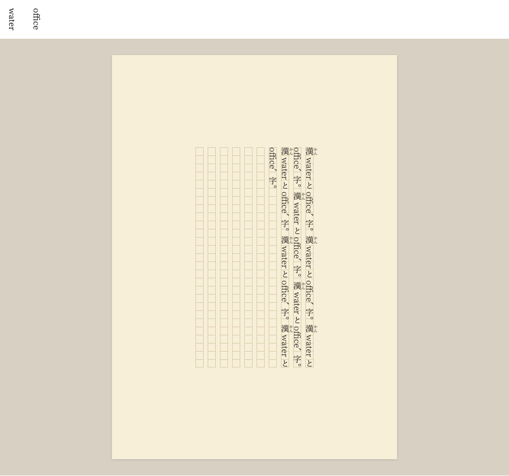
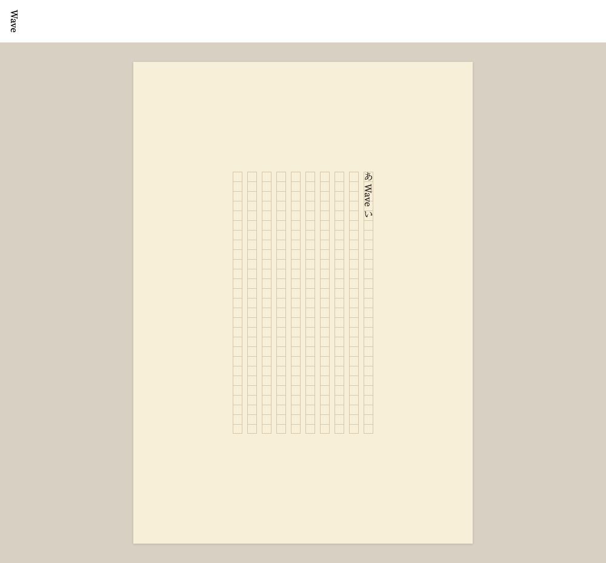
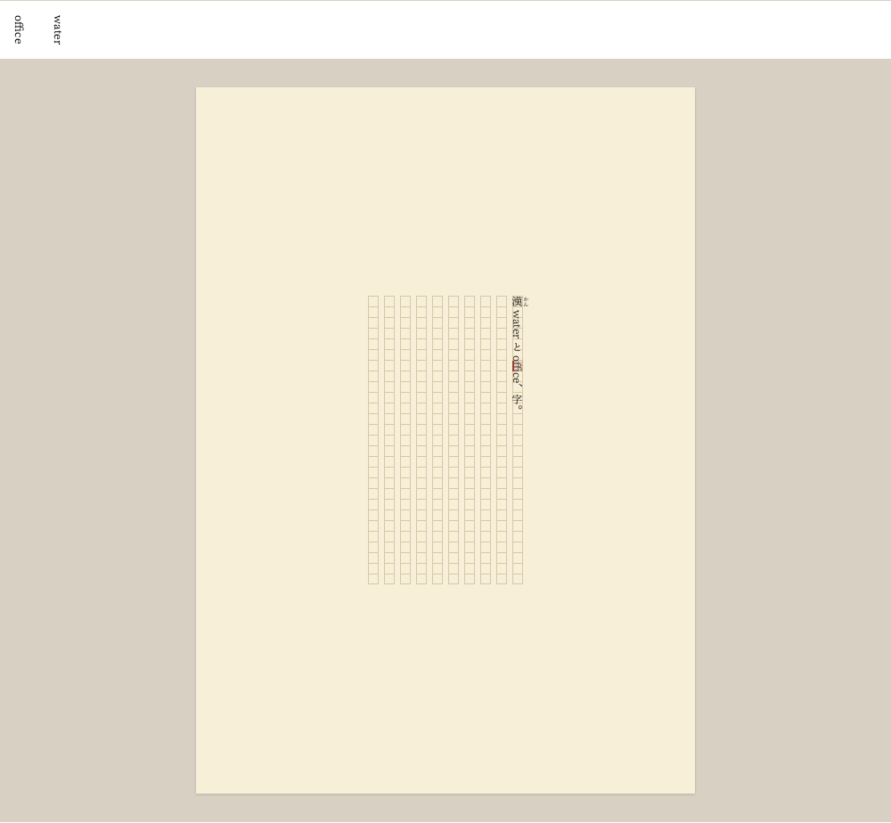

# Japanese fixed pitch and Western font metrics: verification report

The real-font proof passes 36 browser cases, 18 each in Chromium and WebKit.
Japanese text retains one-em pitch. Core accepts clustered measurements for
proportional Western widths, real ligatures, and pair kerning, and the viewer
draws each measured run as one unit. The largest recorded drawing-width error is
0.01525 CSS px; the largest drawing-origin error is 0.012 CSS px. Both are below
the 0.25 CSS-pixel acceptance tolerance.

The result supports [ADR 0007](../../adr/0007-use-japanese-fixed-pitch-and-western-font-metrics.md).
The font provider, loading, and font-family overrides are confined to the proof.
The application still uses the logical measurer and its existing font presets.

## Reproduction and environment

Run `vp run test:font-proof` at the repository root. Setup instructions, original
font identities, download URLs, SHA-256 values, and license handling are in the
[proof README](../../../packages/viewer/font-proof/README.md).

The recorded run was made on 2026-10-10 on macOS arm64 with Node 26.5.0,
Playwright 1.64.0, Chromium 156.0.8078.4, and WebKit reporting Safari 27.2.
fontTools 4.66.1 and uharfbuzz 0.56.3 use HarfBuzz 14.6.0.

The preparation script verifies the original, unmodified font files and shapes
the finite specimen corpus. Browser fixtures independently verify those same
bytes before loading them as `FontFace` instances. They wait for loading to
complete and use matching language, orientation, size, and OpenType features.
Missing fonts, missing glyphs, checksum changes, and unknown measurement requests
fail the proof; no logical substitute is used.

Each browser writes 19 JSON records and corresponding screenshots to
`packages/viewer/font-proof/.cache/evidence/`. The JSON includes browser identity,
font hashes, HarfBuzz version, measured values, glyph-element geometry, and
composed lines with exact/shared source placements. The CI browser job also runs
this task and retains its evidence as an artifact for seven days. The measurements
below were collected locally on macOS. Linux CI execution remains unverified.

## Measured results

Chromium and WebKit returned the same widths for these specimens. Points are
converted to CSS pixels at the standard 96px/in rate: 9pt is 12px and 12pt is 16px.
Native references are unconstrained glyph elements with the same font and text
orientation as the viewer, rather than boxes whose sizes come from core.

| Font and specimen                       | HarfBuzz advance, body em | Browser height at 9pt | Browser height at 12pt |
| --------------------------------------- | ------------------------: | --------------------: | ---------------------: |
| GenEi, `water`                          |              2.7353515625 |           32.828125px |            43.765625px |
| GenEi, `office`, standard ligatures on  |              2.6689453125 |            32.03125px |            42.703125px |
| GenEi, `office`, standard ligatures off |              2.7646484375 |             33.1875px |            44.234375px |
| Source Serif, `Wave`, kerning on        |                     2.376 |           28.515625px |             38.03125px |
| Source Serif, `Wave`, kerning off       |                     2.486 |            29.84375px |             39.78125px |

GenEi Koburi Mincho's Japanese advances are 1024 font units with 1024 units per
em. Small kana and reduced kanji faces therefore retain the same one-em pitch.
Japanese proportional-width and vertical-kerning features are disabled. The
font's vertical substitutions and combining-dakuten composition remain active.

GenEi's `office` uses an `ffi` ligature. It reduces the advance by 98/1024 em
relative to the separate letters. Core emits one sideways render unit while
retaining three shared source ranges for the ligature and exact ranges for the
other letters. Disabling the ligature produces six exact member placements.

GenEi has no standard Western `kern` feature or legacy `kern` table. Enabling
and disabling standard pair kerning therefore leaves `Wave` unchanged. Source
Serif supplies the independent pair-kerning control: `Wave` contracts by 0.110em
with `kern` enabled. This difference is present in both core's measured width
and the browser's actual glyph-element height.

The 189 recorded glyph geometries in each browser have these maximum errors:

| Browser  | Drawing-width error | Drawing-origin error |
| -------- | ------------------: | -------------------: |
| Chromium |           0.01525px |              0.012px |
| WebKit   |           0.01525px |              0.012px |

## Composition and source mapping

The proof also verifies these behaviors:

- An eight-repeat mixed Japanese/Western paragraph retains the measured origins
  across multiple lines at both point sizes, without cumulative drift.
- `漢漢漢漢漢漢漢office字` at a ten-em line length places the real `office` run on
  the first line. The logical half-em-per-letter composition moves it to the
  next line. Line selection therefore uses the real width before rendering.
- `TypographyTypography` remains one indivisible render unit when its measured
  width exceeds the line length.
- `あ゙`, `が`, and supplementary `𠮷` retain complete grapheme/UTF-16 ranges.
- The mixed specimen `｜漢《かん》waterとoffice、字。` preserves half-em punctuation
  boxes, half-size ruby, Western advances, and ligature source positions.
- A diagnostic on one `f` in `office` covers the shared ligature span. Clicking
  the diagnostic band returns the original selected source member.

The ordinary suite passes 525 tests. Format, lint, and type checks pass, and both
packages and the generated frontend build successfully. The core regression
tests also preserve separate rendering for partial bold styling and aggregate
logical measurements.

## Screenshots

The words above the paper are native browser references. The paper uses the
existing viewer layout and ruling with the test fonts. The repeated paragraph
is a controlled glyph specimen, not an excerpt from a novel.

Source Serif's `Wave` uses the measured pair kerning on the paper. The Japanese
characters still use GenEi at fixed pitch.

The WebKit specimen includes ruby and the diagnostic on the shared `ffi` span.

## Production integration boundary

The proof demonstrates the existing contract for a fixed font realization and
the supported Japanese/sideways-Latin corpus. It does not establish automatic
font discovery, fallback, style-aware font selection, arbitrary script shaping,
or exact caret positions inside ligatures. Upright abbreviations, tate-chu-yoko,
and Western punctuation run recognition keep their existing behavior and tests.

Production integration needs a prepared real measurer and renderer configuration
that share font bytes and features, plus application-owned loading and
recomposition. It can reuse the verified clustered contract. The default logical
provider remains available without asynchronous work or downloaded fonts.

## Production provider verification

ADR 0008 adds the browser typography entry point. GenEi fixtures now use its
HarfBuzz/native-browser measurer and ready viewer resource, while numerical
references remain the separately generated Python HarfBuzz catalogue. Source
Serif and feature-off fixtures keep the independent reference provider.

On 2026-10-11, all 36 proof tests and 10 direct production viewer tests passed in
Chromium and WebKit. Direct tests require no fixture CSS overrides. They also
cover uncatalogued Western words, upright abbreviations, two-digit tate-chu-yoko,
missing-character fallback, and shaping boundaries inside bold/italic words.

## Embedded application verification

The final application passed 537 normal tests, including font-loading delay and
failure/retry cases, plus formatting, lint, type checking, and Go tests. The
real-font proof passed 36 cases across Chromium and WebKit.

A built Go binary served the generated application on localhost in a dedicated
Chromium session restricted to localhost requests. The original TTF, WASM, and
license assets loaded from the embedded filesystem. `office` rendered at
2.6692708333 body em against the independent 2.6689453125 em advance, a 0.00390625
CSS-pixel difference at 9pt. `water` rendered at 2.7356770833 em against
2.7353515625 em. No external resource requests occurred. Switching to Gothic,
returning to Mincho, and reloading retained the saved `mincho` setting and ready
font profile. The application screenshot was visually inspected.
